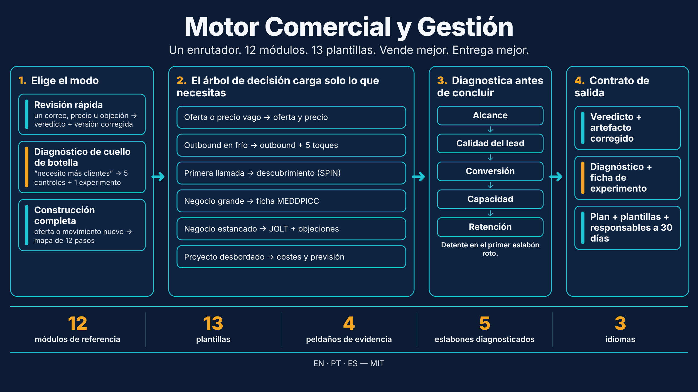
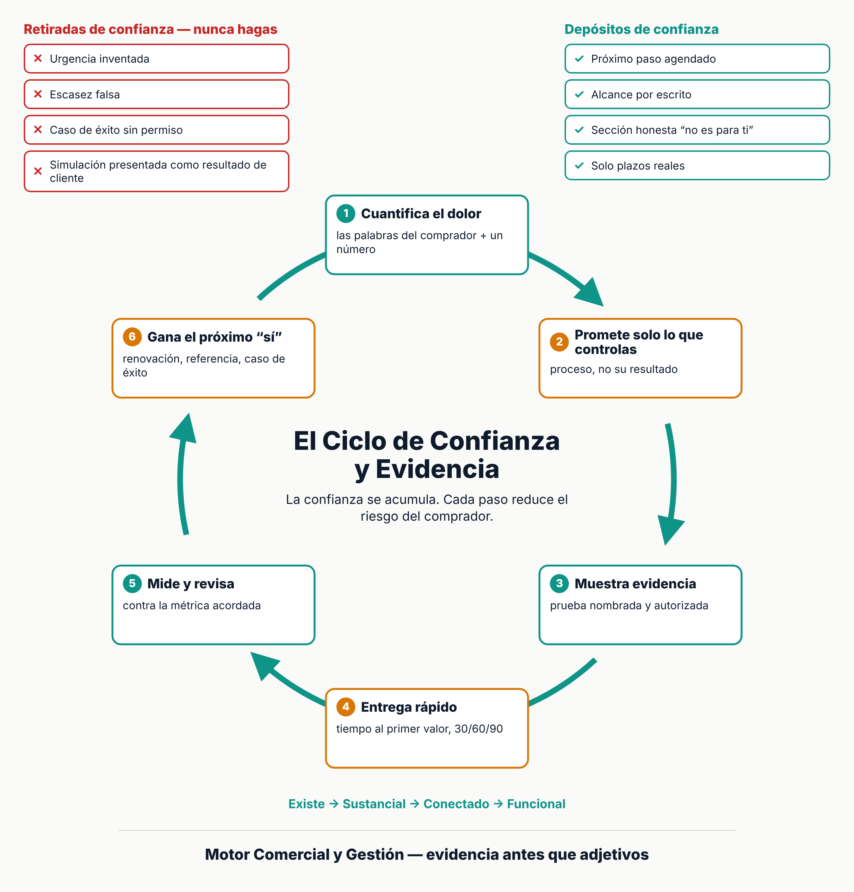

# Motor Comercial y Gestión — Skill para Claude

[English](https://github.com/C48H74/commercial-engine-and-delivery) · [Português](https://github.com/C48H74/motor-comercial-e-gestao-pt) · **Español**



Skill para Claude dirigida a negocios B2B de ciclo complejo. Cubre dos frentes conectados: **vender** (oferta, precio, outbound, descubrimiento, calificación, negociación) y **entregar** (alcance, plazo, coste, riesgo, estado). El frente comercial promete; el de entrega cumple. Usar uno sin el otro rompe el negocio.

| Idioma | Repositorio | Nombre de la skill |
|---|---|---|
| English (principal) | [`commercial-engine-and-delivery`](https://github.com/C48H74/commercial-engine-and-delivery) | `commercial-engine-and-delivery` |
| Português | [`motor-comercial-e-gestao-pt`](https://github.com/C48H74/motor-comercial-e-gestao-pt) | `motor-comercial-e-gestao-pt` |
| Español | [`motor-comercial-y-gestion-es`](https://github.com/C48H74/motor-comercial-y-gestion-es) | `motor-comercial-y-gestion-es` |

Las tres versiones tienen la misma estructura y el mismo contenido. El inglés es la fuente; portugués y español son traducciones.

## Qué cubre

| Parte | Contenido |
|---|---|
| `SKILL.md` | Enrutador: reglas que valen más que todas las demás, 3 modos (revisión rápida, diagnóstico de cuello de botella, construcción completa), tabla situación → módulo, contrato de salida |
| `references/` (12) | Evidencia y perfil, oferta y precio, metodologías de venta (SPIN, MEDDPICC, JOLT, Challenger), outbound y objeciones, motor de 12 pasos, entrega de proyectos (PMBOK 7), costes y previsión (valor ganado, PERT), riesgo, personas y rituales, normas y benchmarks (ISO 21502, ISO 31000, PMI Pulse), arquitectura del motor, validación y negociación |
| `templates/` (13) | Perfil del negocio, guion de validación de idea, guion de venta consultiva, guion de negociación integrativa, propuesta y garantía, ficha de experimento, plan 30/60/90, acta de constitución, informe de estado, matriz RACI, registro de riesgos, guion de kickoff, lista de antipatrones |
| `scripts/` (2) | Validador de estructura y validador de frontmatter YAML (Node.js) |


Toda afirmación necesita fuente, todo dato ausente se convierte en `[a completar]` y toda entrega declara hasta qué peldaño de la escalera de evidencia llegó.



## Instalación

**App/web de Claude:** descarga este repositorio como ZIP y súbelo en el área de skills de tu cuenta.

**Claude Code:**

```bash
git clone https://github.com/C48H74/motor-comercial-y-gestion-es.git ~/.claude/skills/motor-comercial-y-gestion-es
```

## Uso

> Usa la skill motor-comercial-y-gestion-es para revisar la oferta y el precio de mi [describe el negocio].

La skill pregunta primero lo que falta (el mínimo del perfil del negocio) y devuelve un veredicto, el artefacto corregido o un diagnóstico con una ficha de experimento, y cierra con **avanzar / corregir / descartar**.

Valida el paquete después de editarlo:

```bash
node scripts/validar_skill.mjs .
npm install yaml && node scripts/validar_yaml.mjs .
```

## Fuentes y límites

Síntesis de métodos y normas públicos: PMBOK Guide 7.ª edición (PMI), SPIN Selling (Rackham), MEDDPICC, *The Challenger Sale* (Dixon, Adamson), *The JOLT Effect* (Dixon), ISO 21502:2020, ISO 31000:2018, PMI Pulse of the Profession y charlas de profesionales como Rony Meisler y Alfredo Soares.

No todo se verificó en la fuente primaria. Los elementos marcados como **no verificado** o "según el autor" no deben citarse como hecho; la sección *Límites conocidos* de `SKILL.md` enumera lo que sigue abierto. Las cláusulas ISO se sintetizaron a partir de presentaciones de terceros, y la referencia 12 proviene de una recopilación de vídeos no verificada.

Contenido educativo. No sustituye el asesoramiento jurídico, contable o fiscal.

## Licencia

[MIT](LICENSE)

## Autor

Daniel de Souza Paixão — [LinkedIn](https://www.linkedin.com/in/daniel-paixao-b5988230)
